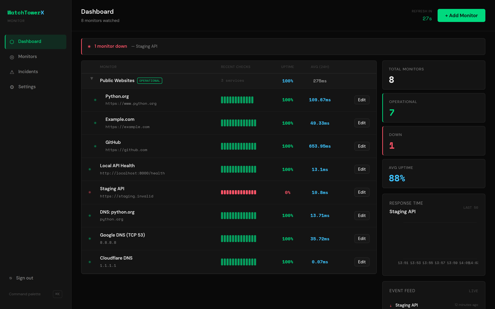

<div align="center" width="100%">
    
</div>

# WatchTowerX

WatchTowerX is an easy-to-use, self-hosted uptime monitoring tool with alerting and public status pages.

<a target="_blank" href="https://github.com/om-ghimire/WatchTowerX"></a> <a target="_blank" href="https://github.com/om-ghimire/WatchTowerX"></a> <a target="_blank" href="https://github.com/om-ghimire/WatchTowerX/issues"></a> <a target="_blank" href="LICENSE"></a>
<a target="_blank" href="https://www.python.org/"></a> <a target="_blank" href="https://fastapi.tiangolo.com/"></a> <a target="_blank" href="https://react.dev/"></a> <a target="_blank" href="https://www.docker.com/"></a>

<!-- Add a dashboard screenshot here, e.g.:

-->

## ⭐ Features

- Monitoring uptime for HTTP(s) / HTTP(s) Keyword / TCP Port / Ping (ICMP) / DNS
- Monitor groups, with the group's status derived from its children
- Configurable check intervals and retries before a monitor is marked down
- Response-time charts, uptime percentages and per-check history
- Notifications via Microsoft Teams (Adaptive Cards) and compatible webhooks, and Email (SMTP, Amazon SES, Microsoft Entra / Graph API)
- Recovery notifications and a test button on every alert channel
- Multiple public status pages at `/status/{slug}`
- Incidents with timeline updates and scheduled maintenance windows
- JWT authentication, first-run setup, staff management with roles, and audit logging
- REST API with interactive OpenAPI docs

## 🔧 How to Install

### 🐳 Docker Compose

```bash
git clone https://github.com/om-ghimire/WatchTowerX.git
cd WatchTowerX
cp .env.example .env
# Edit .env and set SECRET_KEY and REDIS_PASSWORD at minimum
docker compose up -d --build
```

WatchTowerX is now running:

| Service      | URL                          |
| ------------ | ---------------------------- |
| Dashboard    | http://localhost:5173        |
| API docs     | http://localhost:8000/docs   |
| Health check | http://localhost:8000/health |

On first launch, the dashboard asks you to create the initial admin account.

> [!WARNING]
> Change `SECRET_KEY` and `REDIS_PASSWORD` before exposing WatchTowerX to a network. The defaults in `.env.example` are placeholders.

### 💪🏻 Non-Docker

Requirements:

- [Python](https://www.python.org/downloads/) >= 3.12
- [Node.js](https://nodejs.org/en/download/) >= 20
- [PostgreSQL](https://www.postgresql.org/download/) 16
- [Redis](https://redis.io/downloads/) 7
- [Git](https://git-scm.com/downloads)

```bash
git clone https://github.com/om-ghimire/WatchTowerX.git
cd WatchTowerX
cp .env.example .env

# Backend
python -m venv venv
source venv/bin/activate        # Windows: venv\Scripts\activate
pip install -r requirements.txt
uvicorn app.main:app --reload
```

```bash
# Frontend (in a second terminal)
cd frontend
npm install
npm run dev
```

### ⚙️ Configuration

All settings are read from environment variables or `.env`. See [`.env.example`](.env.example).

| Variable                         | Description                        | Default                    |
| -------------------------------- | ---------------------------------- | -------------------------- |
| `APP_NAME`                       | Application name                   | `WatchTowerX`              |
| `SECRET_KEY`                     | JWT signing key. **Change this!**  | `change-me-in-production`  |
| `ALGORITHM`                      | JWT algorithm                      | `HS256`                    |
| `ACCESS_TOKEN_EXPIRE_MINUTES`    | Token lifetime in minutes          | `60`                       |
| `DATABASE_URL`                   | Async PostgreSQL connection string | `postgresql+asyncpg://...` |
| `REDIS_URL`                      | Redis connection string            | `redis://localhost:6379`   |
| `REDIS_PASSWORD`                 | Redis password                     | *(empty)*                  |
| `DEFAULT_CHECK_INTERVAL_MINUTES` | Default check interval             | `5`                        |

Email alerts (SMTP, SES or Microsoft Entra Graph) are configured per alert channel under **Settings** in the dashboard. For Microsoft Entra, the app registration needs the `Mail.Send` application permission with admin consent.

## 🆙 How to Update

```bash
cd WatchTowerX
git pull
docker compose up -d --build
```

For a non-Docker install, run `git pull`, then `pip install -r requirements.txt` and `npm install` in `frontend/`, and restart both processes.

## 🆕 What's Next?

- [ ] Slack, Discord and Telegram alert channels
- [ ] SSL certificate expiry monitoring
- [ ] Multi-region checks
- [ ] Alembic migrations
- [ ] Production Docker image for the frontend

Have an idea? [Open an issue](https://github.com/om-ghimire/WatchTowerX/issues).

## 🖼 More Screenshots

<!-- Add screenshots here, e.g.:

Status Page:


Settings Page:


-->

_Screenshots coming soon._

## 🧱 Tech Stack

| Layer      | Technology                                   |
| ---------- | -------------------------------------------- |
| Backend    | Python 3.12, FastAPI, SQLAlchemy 2 (async)   |
| Database   | PostgreSQL 16 (asyncpg)                      |
| Cache      | Redis 7                                      |
| Scheduler  | APScheduler                                  |
| Frontend   | React 18, Vite, TanStack Query, React Router |
| Charts     | Recharts                                     |
| Auth       | JWT (python-jose, passlib/bcrypt)            |
| Deployment | Docker and Docker Compose                    |

<details>
<summary><b>📖 API Reference</b></summary>

Interactive OpenAPI docs are available at **`/docs`** (Swagger UI) and **`/redoc`** once the API is running.

| Area           | Method(s)              | Endpoint                                           |
| -------------- | ---------------------- | -------------------------------------------------- |
| Auth           | `GET`                  | `/api/auth/setup`                                  |
|                | `POST`                 | `/api/auth/register`, `/api/auth/login`            |
|                | `GET`                  | `/api/auth/me`                                     |
| Staff          | `GET` `POST`           | `/api/auth/staff`                                  |
|                | `PATCH` `DELETE`       | `/api/auth/staff/{id}`                             |
| Monitors       | `GET` `POST`           | `/api/monitors/`                                   |
|                | `GET` `PATCH` `DELETE` | `/api/monitors/{id}`                               |
| Results        | `GET`                  | `/api/monitors/{id}/results`                       |
|                | `GET`                  | `/api/monitors/{id}/stats?hours=24`                |
| Groups         | `GET` `POST`           | `/api/groups`                                      |
|                | `PATCH` `DELETE`       | `/api/groups/{id}`                                 |
|                | `GET` `POST`           | `/api/groups/{id}/children`                        |
|                | `PATCH`                | `/api/groups/{id}/children/reorder`                |
| Alert channels | `GET` `POST`           | `/api/alert-channels/`                             |
|                | `PATCH` `DELETE`       | `/api/alert-channels/{id}`                         |
|                | `POST`                 | `/api/alert-channels/{id}/test`                    |
| Status pages   | `GET` `POST`           | `/api/status-pages`                                |
|                | `PATCH` `DELETE`       | `/api/status-pages/{id}`                           |
| Components     | `GET` `POST`           | `/api/status-pages/{id}/components`                |
| Incidents      | `GET` `POST`           | `/api/status-pages/{id}/incidents`                 |
|                | `POST`                 | `/api/status-pages/{id}/incidents/{iid}/updates`   |
| Maintenance    | `GET` `POST`           | `/api/status-pages/{id}/maintenance`               |
|                | `POST`                 | `/api/status-pages/{id}/maintenance/{mid}/updates` |
| Public         | `GET`                  | `/status/{slug}`, `/api/status/{slug}`             |
| Health         | `GET`                  | `/health`                                          |

</details>

## Motivation

- I wanted a self-hosted tool that combines uptime monitoring, team alerting and a public status page in one place.
- Native alerting for the tools my team already uses: Microsoft Teams and Microsoft 365 email.
- Learn async Python with FastAPI and SQLAlchemy 2, and build a fast React dashboard on top of it.

If you love this project, please consider giving it a ⭐.

## 🗣️ Discussion / Ask for Help

For bugs, questions and feature requests, please use [GitHub Issues](https://github.com/om-ghimire/WatchTowerX/issues).

If you find a security vulnerability, please **do not** open a public issue. Report it privately through [GitHub Security Advisories](https://github.com/om-ghimire/WatchTowerX/security/advisories/new).

## Contributions

### Create Pull Requests

Pull requests are awesome.

1. Fork the repository
2. Create a branch: `git checkout -b feat/my-feature`
3. Commit using [Conventional Commits](https://www.conventionalcommits.org/): `git commit -m "feat: add my feature"`
4. Push: `git push origin feat/my-feature`
5. Open a Pull Request

Please keep PRs focused (one feature or fix per PR) and add tests for new backend behaviour.

### Run the Tests

```bash
pip install -r requirements.txt
pytest
```

The tests use an in-memory SQLite database (`aiosqlite`), so you don't need PostgreSQL to run them.

## 📄 License

WatchTowerX is released under the [MIT License](LICENSE).
